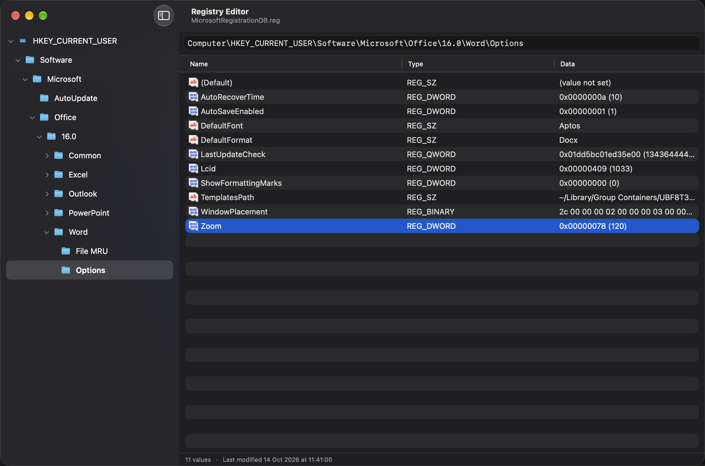
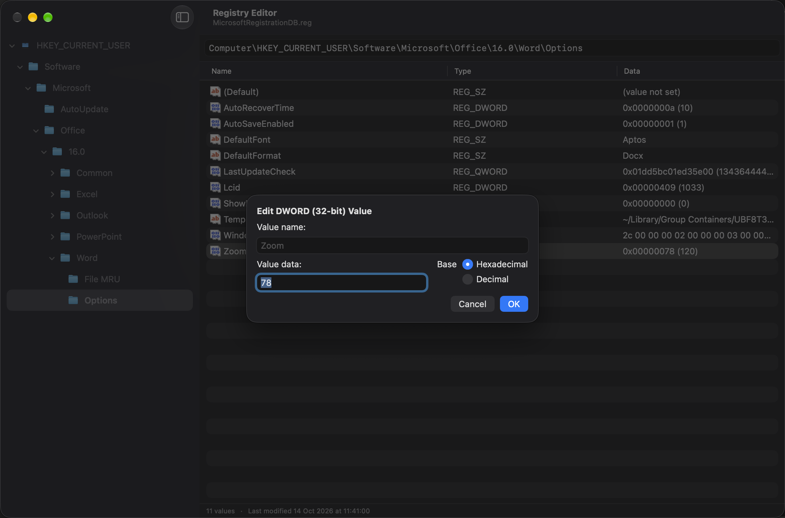
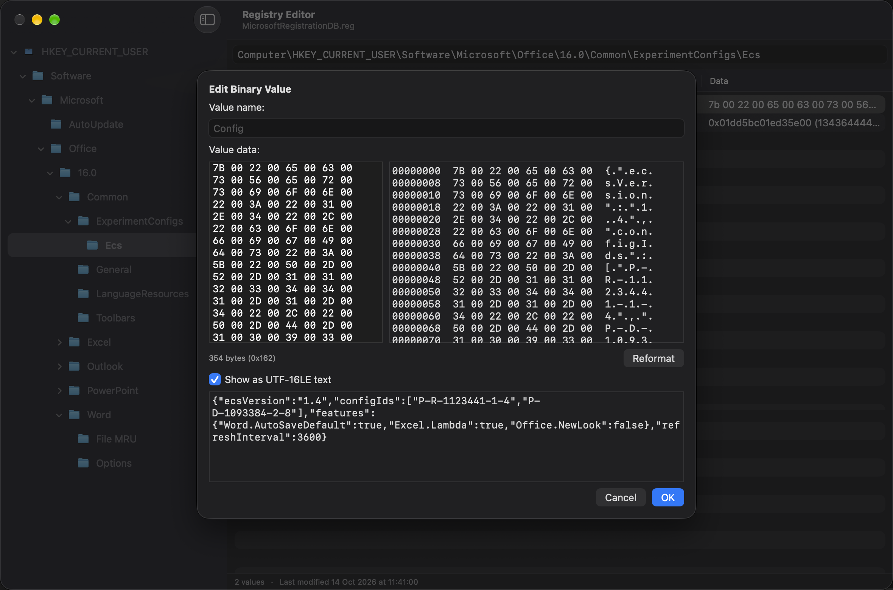
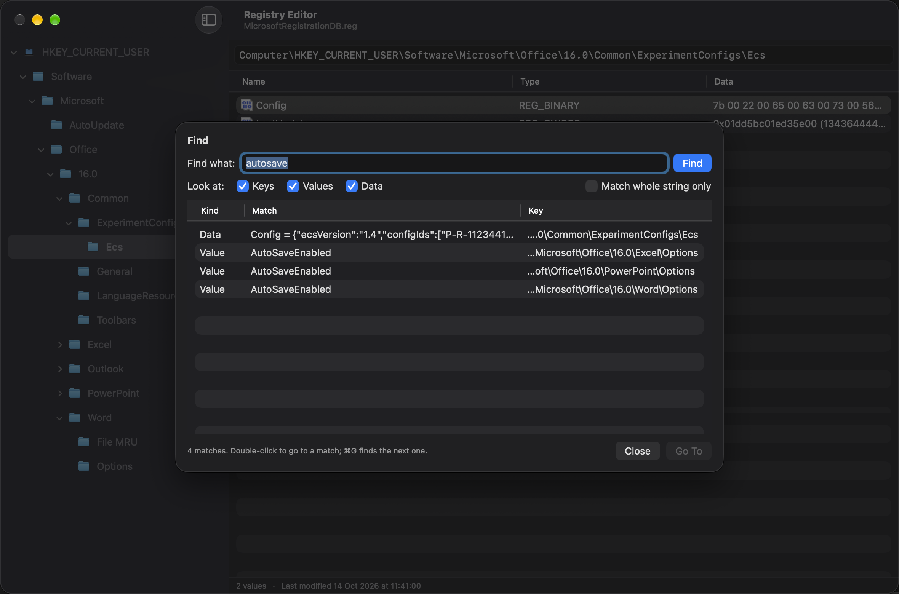

# MacOfficeRegedit

Registry editor for "Microsoft Office for Mac".

Office for Mac keeps its Windows-style `HKEY_CURRENT_USER` registry in a SQLite database at
`~/Library/Group Containers/UBF8T346G9.Office/MicrosoftRegistrationDB.reg`. This app browses and edits it
with a UI modelled after Windows `regedit`.

<p align="center">
  
</p>

## Installation

1. Download the DMG of the [latest release](https://github.com/sli-do-playground/MacOfficeRegedit/releases/latest).
   Every merge to `main` publishes a new one.
2. Open it and drag **MacOfficeRegedit** to **Applications**.
3. Releases are not signed with a Developer ID yet, so macOS blocks the first launch. Click **Open Anyway** in
   *System Settings ▸ Privacy & Security*, or run `xattr -dr com.apple.quarantine /Applications/MacOfficeRegedit.app`.

Requires macOS 13.1 or later and Microsoft Office for Mac (which creates the registry). macOS may ask to allow
access to data from other apps the first time the app opens Office's registry.

## Features

- Key tree with an address bar (accepts `Computer\HKEY_CURRENT_USER\…`, `HKCU\…` or relative paths)
- Values table with sortable columns, Windows-style formatting and last-modified time of the key
- Create, rename and delete keys and values (`REG_SZ`, `REG_EXPAND_SZ`, `REG_MULTI_SZ`, `REG_DWORD`, `REG_QWORD`, `REG_BINARY`)
- Editors for strings, multi-strings, DWORD/QWORD (hexadecimal/decimal) and binary data (hex dump, UTF-16 text preview)
- Find (⌘F) across key names, value names and data, Find Next (⌘G)
- Export a key (or the whole hive) to a `.reg` file and import `.reg` files, compatible with Windows `regedit`
- Copy key name, copy value data
- Live refresh when Office changes the database; warning while Office apps are running

| Edit a DWORD in hexadecimal or decimal | Binary data as hex, with a UTF-16 text preview |
| :---: | :---: |
|  |  |

<p align="center">
  <br>
  <em>Find searches key names, value names and data, including text stored in binary values.</em>
</p>

## Safety

- Before the first modification of an opened database, a consistent copy is saved to
  `~/Library/Application Support/MacOfficeRegedit/Backups` (the 30 most recent backups are kept;
  *File ▸ Show Backups in Finder*). To restore, quit Office, copy a backup over the file the
  `MicrosoftRegistrationDB.reg` symlink points to, and delete any `-journal`, `-wal` or `-shm` file next to it.
- Quit Office apps before editing: they read settings at launch and may overwrite changes when they quit.
- *File ▸ Open Database…* opens any copy of the database instead of the live one.

## Development

Open `src/MacOfficeRegedit.xcodeproj` (Xcode 16+; the project uses synchronized folders, so new files are picked up automatically).

Launch arguments (*Product ▸ Scheme ▸ Edit Scheme ▸ Arguments*):

- `-RegistryDatabasePath /path/to/copy.reg` – open a different database, e.g. a copy, instead of the live registry
- `-RegistryReadOnly YES` – open read-only
- `-RegistryBackupsPath /path/to/dir` – save automatic backups elsewhere

Tests:

- `MacOfficeRegeditTests` – unit tests; they create temporary databases and never touch the live registry.
  `RealDatabaseTests` round-trips a real registry through `.reg` export/import when `REGEDIT_TEST_DB` points to a **copy**:
  ```
  cp ~/Library/Group\ Containers/UBF8T346G9.Office/MicrosoftRegistrationDB.reg /tmp/copy.reg
  TEST_RUNNER_REGEDIT_TEST_DB=/tmp/copy.reg xcodebuild -project src/MacOfficeRegedit.xcodeproj -scheme MacOfficeRegedit test
  ```
- `MacOfficeRegeditUITests` – UI tests against a generated fixture database (require granting UI automation access).

### Screenshots

`scripts/update-screenshots.sh` regenerates the images in `docs/screenshots` by running `ScreenshotTests`, a UI test
that opens a demo registry with made-up values (never a real one, which holds account details). Like the other UI
tests it needs UI automation access; the screenshots follow the system's light or dark appearance.

### Building a DMG

`scripts/build-dmg.sh [output-dir]` archives a universal (Apple silicon and Intel) Release build and packages it
as `MacOfficeRegedit-<version>-<build>.dmg`, with a link to `/Applications` for drag-and-drop installation.
Without signing settings the app is signed ad hoc; see the script header for the Developer ID and notarization
variables.

### Releases

The [Build DMG](.github/workflows/build-dmg.yml) workflow runs on the `xcode-27` GitHub runner with Xcode 27.1.
It runs the unit tests and builds the DMG for every pull request (download it from the run's artifacts), and on
every push to `main` it also publishes a GitHub release `v<version>-<run number>` with the DMG attached.

Releases are signed ad hoc unless these repository secrets are set, so macOS blocks them on first launch
(open them from *System Settings ▸ Privacy & Security*). Signing secrets are never used for pull requests.

| Secret | Purpose |
| --- | --- |
| `DEVELOPER_ID_CERTIFICATE_P12` | Base64-encoded "Developer ID Application" certificate and private key (`.p12`) |
| `DEVELOPER_ID_CERTIFICATE_PASSWORD` | Password of the `.p12` |
| `DEVELOPER_ID_APPLICATION` | Signing identity, e.g. `Developer ID Application: Name (TEAMID)` |
| `DEVELOPMENT_TEAM` | Team ID |
| `NOTARY_APPLE_ID`, `NOTARY_TEAM_ID`, `NOTARY_PASSWORD` | Apple ID, team and app-specific password for notarization (optional) |

### Layout

| Folder | Contents |
| --- | --- |
| `App` | App entry point and menu commands |
| `Models` | Keys, values, typed value data, FILETIME and path helpers |
| `Database` | `RegistryDatabase` – all SQL access (reads, transactional writes, backups) |
| `Store` | `RegistryStore` – UI state and operations; file watcher; running Office apps monitor |
| `RegFile` | `.reg` file parser and serializer |
| `Views` | SwiftUI views and value editors |
